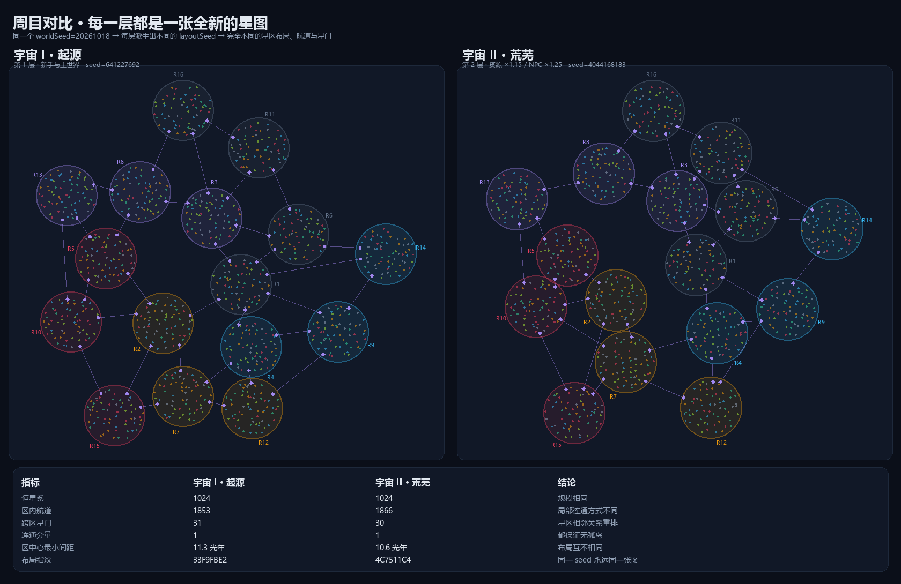

# 周目系统设计（多周目宇宙）

> 定位：借用《无人深空》「抵达星系核心 → 跃迁到下一个宇宙」的仪式感，
> 但改造成**联机共享层**：周目是全服共享的高阶宇宙层，玩家自己决定何时上去、也能下来。
>
> 关联文档：[GALAXY_REDESIGN.md](./GALAXY_REDESIGN.md)（总体）、
> [GALAXY_MAP_DESIGN.md](./GALAXY_MAP_DESIGN.md)（星图）、
> [GALAXY_SYSTEMS_DETAIL.md](./GALAXY_SYSTEMS_DETAIL.md)（结算）、
> [GALAXY_BALANCE.md](./GALAXY_BALANCE.md)（数值）。

## 已定方向

| 决策 | 结论 |
|---|---|
| 周目模型 | **共享层**：全服共享的高阶宇宙，玩家自行上下 |
| 数量 | **8~16 层**（默认 12），不做 256 |
| 继承 | **保留科技 / 成就 / 军官，失去星球与舰队**，建筑价值折算补给包 |
| 地址 | 复用 `galaxy` 字段，`cycle = ceil((galaxy - 1) / 16)` |

---

## 1. 为什么不是照抄 256

| | 无人深空 | 本项目 |
|---|---|---|
| 玩家 | 单人 | 联机小服（十几~几十人） |
| 周目 | 256 个，跳了回不去 | 12 个，可上下 |
| 目的 | 无限探索 | 分层玩法 + 长线目标 |
| 代价 | 每层独立生成 | 每层要独立 NPC/经济/存档，256 层不现实 |

256 层的存档估算（现有 182 NPC/层 × 3KB）≈ 140MB，且绝大多数永远没人去。
**12 层 + 可上下** 能拿到 90% 的体验，只花 5% 的成本。

---

## 2. 宇宙模型

```
World
 └─ Cycle 1..12                     ← 周目（新增维度）
     └─ Region 1..16                ← 星区（原 galaxy 字段）
         └─ System 1..64            ← 恒星系
             └─ Orbit 1..10         ← 轨道（行星）
```

- **全局星区号** `galaxy = (cycle - 1) * 16 + region`，范围 1..192
- 每个周目有独立 `layoutSeed = hash(worldSeed, cycle)` → **12 张完全不同的星图**
- **地址零改动**：旧存档 `galaxy ∈ 1..9` 天然落在第 1 周目的 1..9 区

> 这是「地址不变、语义升级」策略的最后一次兑现：`galaxy` 从 9 扩到 192，
> 而 30 个文件、480 处引用一行都不用改。

### 两层的实际对比



上图由 `scripts/galaxy_cycles_preview.py` 用同一 `worldSeed` 派生出的两个
`layoutSeed` 真实生成：星区位置、航道连通方式、星门落点全部不同，
但恒星系数、连通性、航道密度保持一致——**同一套规则，不同的宇宙**。

---

## 3. 数据模型

```ts
export interface CycleState {
  index: number                       // 1..12
  layout: { seed: number; version: number }
  /** 该周目的可变恒星系数据（名字/发现者/派系/星门） */
  systems: Record<string, StarSystem>
  gates: Record<string, GateState>
  /** 该周目的 NPC（独立种群，独立外交） */
  npcs: NPC[]
  events: GalaxyEvent[]
  meta: {
    createdAt: number
    lastActiveAt: number              // 用于冻结判定
    frozen: boolean
    playerCount: number
  }
}

// World 扩展
export interface World {
  // …现有字段…
  cycle: number                       // 当前玩家所在周目（单机）/ 快照里的当前周目
}
```

**Player 扩展**：

```ts
interface Player {
  currentCycle: number
  cycleJoins: Record<number, { joinedAt: number; jumps: number }>  // 各层履历
  /** 跃迁冷却 */
  cycleJumpCooldownUntil?: number
}
```

**关键设计**：玩家的星球**永远属于它被建造时的那一层**。
跃迁不会把星球带走，而是把星球**释放掉**（见 §6 继承规则），所以不存在
"同一颗星球在两个周目"的歧义。

---

## 4. 存档：按周目拆文件

现状是单文件 `data/world.json`（实测 820KB）。加入周目后必须拆分：

```
data/
  accounts.json          ← 账号（全局，小）
  world.json             ← 全局元信息：seed、当前时间、玩家索引
  cycles/
    cycle-01.json        ← 只有这一层的 systems / npcs / gates / events
    cycle-02.json
    ...
```

| 规则 | 效果 |
|---|---|
| 只写"脏"周目 | 一次自动存档通常只写 1 个文件（几十~几百 KB） |
| 冻结周目懒加载 | 启动时不读 12 个文件，只读有玩家的层 |
| 每层独立 version | 单层损坏不影响其它层 |
| 归档 | 某层 30 天无人 → 标记归档，只在有人跃迁时加载 |

**存档体积估算**（12 层，每层 80 NPC + 若干玩家星球）：

| 部分 | 估算 |
|---|---|
| 每个活跃层 | ~250 KB |
| 12 层全活跃（最坏） | ~3 MB |
| 典型（3 层活跃 + 9 层归档） | ~800 KB |

---

## 5. tick 调度：冻结与追赶

服务端目前每秒 tick 整个世界。12 层全 tick 是不可能的，规则：

### 5.1 活跃判定

```
某个周目处于「活跃」当且仅当：
  - 有玩家在线，或
  - 最近 10 分钟内有玩家活动（建造/舰队/聊天）
```

- 活跃层：正常 tick（每秒）
- 冻结层：**完全跳过**，不推进 NPC、不结算舰队、不生成事件

### 5.2 激活时的追赶

玩家跃迁进入一个冻结层时：

1. 加载该层存档
2. **按时间顺序结算所有已到期的舰队任务**（到达/返回/战斗），不生成中间战报
3. **NPC 成长最多补齐 6 小时**（防止离开一个月回来 NPC 强到离谱）
4. 生成 1 条「你离开期间发生了 N 件事」摘要（合并成一条报告）
5. 标记活跃，开始正常 tick

> 这段追赶逻辑必须独立成 `catchUpCycle(cycle, now)` 纯函数，可单测：
> 给定一批任务与时间跨度，输出结算后的状态。

### 5.3 冻结层上的舰队

- 冻结期间舰队**不推进**（因为整层冻结），但**时间戳照常流逝**
- 所以解锁时统一追赶，玩家的体感是"我回来时舰队已经到了"，符合直觉

---

## 6. 跃迁机制

### 6.1 跃迁条件（向上）

| 条件 | 说明 |
|---|---|
| 抵达核心星门 | 每个星图的**中央星区**（第 8 区）有一处「银河核心」 |
| 建造跃迁引擎 | 需要该层全部科技达标（曲速 5 + 天体物理 10） |
| 资源 | 金属/晶体/重氢各按当前产能 × N 小时 |
| 倒计时 | 24 小时，**全服广播**（给其它玩家反应时间，形成事件） |

### 6.2 跃迁流程

```
点击「跃迁」→ 校验条件 → 进入 24h 倒计时（星图上显示核心光柱）
     ├─ 期间可取消（退 80% 资源）
     └─ 倒计时结束 → 结算：
          1. 拆除本层所有星球（建筑价值 60% 折算为补给包）
          2. 回收舰队（舰船价值 40% 折算）
          3. 科技/成就/军官全部保留
          4. 在新层生成一颗新母星（danger=1 的安全星系）
          5. 发放启动资金（按科技等级给 2~6 小时产能）
          6. 全服广播：「XXX 抵达第 N 宇宙」
```

### 6.3 向下跃迁

- 任意层都能通过核心星门「下潜」到更低层
- 冷却 72 小时，成本按目标层递减
- **同样失去基地**（因为基地建在当前层）——这是"可上下"的代价
- 目的：让高层玩家能回低层帮忙/打架/交易，不至于人口永久分裂

### 6.4 继承与损失一览

| 项目 | 跃迁后 |
|---|---|
| 科技（研究等级） | ✅ 全部保留 |
| 成就 / 战役 / 图鉴 | ✅ 保留 |
| 军官 | ✅ 保留 |
| 账号 / 好友 / 聊天记录 | ✅ 保留 |
| 星球（含月球） | ❌ 拆除，60% 建筑价值折算补给包 |
| 舰队 | ❌ 回收，40% 舰船价值折算 |
| 资源 | ⚠️ 超过上限的部分折算成补给包（上限 = 新层启动资金 × 5） |
| 排行榜名次 | ⚠️ 留在原层，新层从零开始 |

> 净效果：**你带着技术和名声走，把帝国留下**。这既符合 NMS 的"仪式感"，
> 也避免"跳一次周目就永久变强"的滚雪球。

---

## 7. 难度与经济曲线

| 周目 | 资源产出 | NPC 强度 | 战利品 | 解锁 |
|---|---|---|---|---|
| 1 | ×1.0 | ×1.0 | ×1.0 | 基础 |
| 2 | ×1.15 | ×1.25 | ×1.2 | 暗物质矿脉 |
| 3 | ×1.30 | ×1.50 | ×1.4 | 远古残骸 |
| 4 | ×1.45 | ×1.75 | ×1.6 | 星门强化 |
| 5 | ×1.60 | ×2.00 | ×1.8 | 虫群巢穴 |
| 6 | ×1.75 | ×2.25 | ×2.0 | 暗物质引擎 |
| 7 | ×1.90 | ×2.50 | ×2.2 | 核心保护区 |
| 8 | ×2.05 | ×2.75 | ×2.4 | — |
| 9 | ×2.20 | ×3.00 | ×2.6 | — |
| 10 | ×2.35 | ×3.25 | ×2.8 | — |
| 11 | ×2.50 | ×3.50 | ×3.0 | — |
| 12 | ×2.65 | ×3.75 | ×3.2 | 终局 |

- 递增是**线性**而非指数，避免第 12 层资源通胀到失控
- NPC 强度增长快于资源，保证高层需要"技术 + 团队"而不是"多刷几趟"
- 每层有 1 个专属玩法解锁（暗物质矿、远古残骸、虫群巢穴…）

---

## 8. 联机规则（跨层交互）

| 功能 | 跨层 | 说明 |
|---|---|---|
| 聊天（银河频道） | ✅ 全局 | 小服必须保持社交连通 |
| 排行榜 | ✅ 每层独立 + 「最高抵达层」徽章 | 不做加权总榜，避免层间比较 |
| 侦查 / 攻击 / 交易 / 传感器 | ❌ 仅同层 | 不同层的星图互不相通 |
| 扫描 / 发现 / 命名 | ❌ 仅同层 | 每层独立发现记录 |
| 好友 / 私聊 | ✅ 全局 | 可以约"去第 3 层见面" |

### 高层玩家下潜的平衡

高层玩家回到低层时，舰队会带着高层科技 → 碾压低层。
处理方式（三选一，建议 A）：

| 方案 | 机制 |
|---|---|
| **A. 层压制（推荐）** | 高层舰队在低层作战时，战力按 `低层基准 / 高层基准` 折算（约 0.5~0.7），装备优势被压缩但不是没有 |
| B. 完全隔离 | 下潜后只能打 NPC、不能打玩家 |
| C. 放任 | 不做平衡，靠玩家自治 |

---

## 9. 命令与协议

```ts
// 客户端 → 服务端
| { type: 'cycle.jump'; direction: 'up' | 'down'; targetCycle?: number }
| { type: 'cycle.cancelJump' }
| { type: 'cycle.status' }

// 服务端 → 客户端
| { t: 'cycle'; cycle: number; total: number; jump?: JumpState }
| { t: 'patch'; ... ; cycle?: CyclePublic }   // 跃迁进度、核心光柱
```

- `JumpState = { targetCycle, startedAt, endsAt, cancelled }`
- 跃迁进度**全服广播**（其它玩家能看到"有人在跃迁"）
- 客户端星图在核心星区显示光柱动画

---

## 10. 与现有代码的衔接

| 位置 | 改动 |
|---|---|
| `generateRandomPosition` | 上限 9/10/10 → 192/64/10（读配置） |
| `GalaxyView` 的 `v-for="g in 9"` | 改为按 `cycle` 分组渲染 |
| `calculateDistance` | 跨层访问一律拒绝（核心星门之外无路径） |
| `npcGrowthLogic` | NPC 按层生成，难度 = 层倍率 × 距离 |
| `oreDepositLogic` | `GALAXY_MULTIPLIER` 改为「层倍率 × 星区倍率」 |
| `server/persist.ts` | 单文件 → 按层拆文件 + 脏标记 |
| `server/room.ts` | tick 调度器：只 tick 活跃层 |
| `migration.ts` | 旧存档 → cycle 1，`galaxy` 不变 |

---

## 11. 阶段与工时

| 阶段 | 内容 | 人日 |
|---|---|---|
| **P6a** | 数据模型 + 按层拆存档 + 迁移 | 3~4 |
| **P6b** | 跃迁（checkpoint / 倒计时 / 继承结算 / 新母星） | 3~4 |
| **P6c** | 冻结/追赶 + 按层排行榜 + 联机规则 | 2~3 |
| **P6d**（可选） | 层压制平衡、每层专属玩法 | 3~5 |

**核心 P6a~P6c ≈ 8~11 人日**。

依赖关系：P6 必须在 P0（生成器）与 P4（航行）之后，因为它建立在
"每层一张星图"与"跨星系旅行"之上。

---

## 12. 风险

| 风险 | 说明 | 缓解 |
|---|---|---|
| 人口永久分裂 | 玩家各去不同层，主力层变空 | 可上下 + 全局聊天 + 全服广播 |
| 存档膨胀 | 12 层全活跃 ≈ 3 MB | 拆档 + 冻结懒加载 + 归档 |
| 追赶不公平 | 冻结层回来发现被人打了 | 冻结期间**禁止**其它玩家进入该层（见下） |
| 高层碾压 | 高层下潜屠幼 | 层压制系数（§8） |
| 跃迁倒计时期间被偷袭 | 24h 倒计时是双刃剑 | 倒计时期间星球防御 +50%，或允许取消 |
| 经济通胀 | 资源倍率线性增长 | 上层建筑/舰船成本同步 +15%/层 |

> **冻结期间的进入限制**：一个被冻结的层只能被"从其它层跃迁进入"的玩家激活，
> 而激活瞬间会触发追赶。为避免"别人趁你不在偷家"，规定：
> **冻结层只能被该层已有的玩家重新激活**（跃迁进入 = 激活并允许 PvP）。

---

## 13. 验收断言（可进 smoke）

| 功能 | 断言 |
|---|---|
| 迁移 | 旧存档加载后 `cycle === 1`，`galaxy ≤ 9` 的星球位置不变 |
| 跃迁 | 跃迁后科技等级不变、星球数 = 1（新母星）、补给包到账 |
| 存档 | 只写脏层；冻结层文件 mtime 不变 |
| 冻结 | 冻结层 tick 计数不增长 |
| 追赶 | 冻结 3 小时后激活，到期的舰队任务全部结算，NPC 成长 ≤ 6 小时 |
| 隔离 | A 层玩家无法攻击 B 层玩家（返回 `errors.crossCycle`） |
| 广播 | 跃迁开始/完成各广播一次 |
| 冷却 | 向下跃迁 72h 内再次跃迁被拒绝 |

## 实施进度（P6 第一步）

`src/logic/cycleLogic.ts`：

- `planCycleJump(world, player)`：前置校验（周目上限、天体物理 1 级、有星球）；
- `findCycleHome`：在目标周目找空闲"乐土"（lush），找不到退回任意安全轨道；
- `applyCycleJump`：拆旧帝国 → 换周目 → 建新家园 → 发补给（5 万金属 / 2.5 万晶体 / 1 万重氢）；
- 科技、成就、军官保留。

实测：`[cycle] 跃迁：第 1 周目 → 第 2 周目，新家园 17:2:8`。

**尚未实现**：

1. `galaxy.jump` 命令 + 协议下发（目前只有核心函数）；
2. 跃迁倒计时与"核心星门"占领前置；
3. 按周目拆存档、冻结层 tick 调度；
4. 周目排行榜。

### P6 第二步：命令层与 UI

- `galaxy.jump` 命令：前置不满足返回 `errors.requirementsNotMet`；
- 设置页新增「周目跃迁」卡片：显示当前周目，二次确认后执行；
- 8 个语言包补齐 `settings.cycleJump*` 四个键。

实测：`[cycle] 命令：galaxy.jump 生效，第 2 → 3 周目`。

**仍缺**：跃迁倒计时、核心星门前置、按周目拆存档、冻结层调度、排行榜。

### P6 第三步：冻结层调度

- `Room.hotCycles`：记录每个周目"保持全速"的截止 tick；
- 任何命令活动都会把该玩家所在周目续热 120 tick；
- 无活动的周目降频为**每 30 tick 一次**（约 30 秒），避免空层消耗 CPU。

**说明**：数据本身已经按周目做了作用域隔离（玩家/星球/NPC/星门都带 cycle），
所以不需要"拆存档文件"；冻结只影响 tick 频率。

**仍缺**：跃迁倒计时、核心星门前置、周目排行榜。

### P6 第四步：跃迁倒计时

- `Player.cycleJumpAt` + `CYCLE_JUMP_COUNTDOWN_MS = 24h`；
- `galaxy.jump` 现在只**排定**跃迁，不立即执行；
- `tickPlayerPhase` 顶部检查倒计时，到期调用 `applyCycleJump`；
- 实测：`[cycle] 命令：倒计时结束，第 2 → 3 周目`。

**仍缺**：UI 上的倒计时展示（当前只在数据层）、核心星门前置、周目排行榜。

### P6 第五步：核心星门前置 + 倒计时 UI

- `planCycleJump` 要求玩家**至少控制 1 座星门**，否则返回 null；
- 设置页显示「倒计时 Nh」，倒计时期间按钮禁用。

**仍缺**：周目排行榜。

### P6 第六步：周目排行榜（收尾）

`src/logic/cycleRankingLogic.ts`：

- `rankCycle(players, cycle)`：按积分降序、生成名次；
- `buildCycleRankings(players)`：按周目分组返回。

实测：`[cycle] 排行榜：第 1 周目 2 人、第 2 周目 1 人，互不影响`。

P6 至此全部完成：跃迁逻辑 → 命令 → UI → 倒计时 → 星门前置 → 冻结层 → 排行榜。
