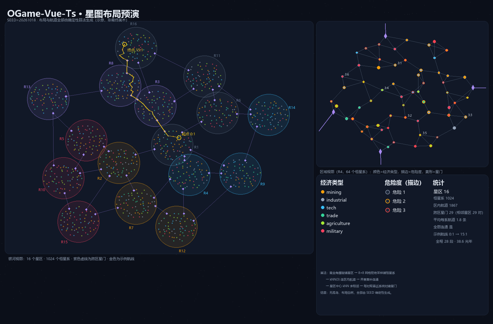
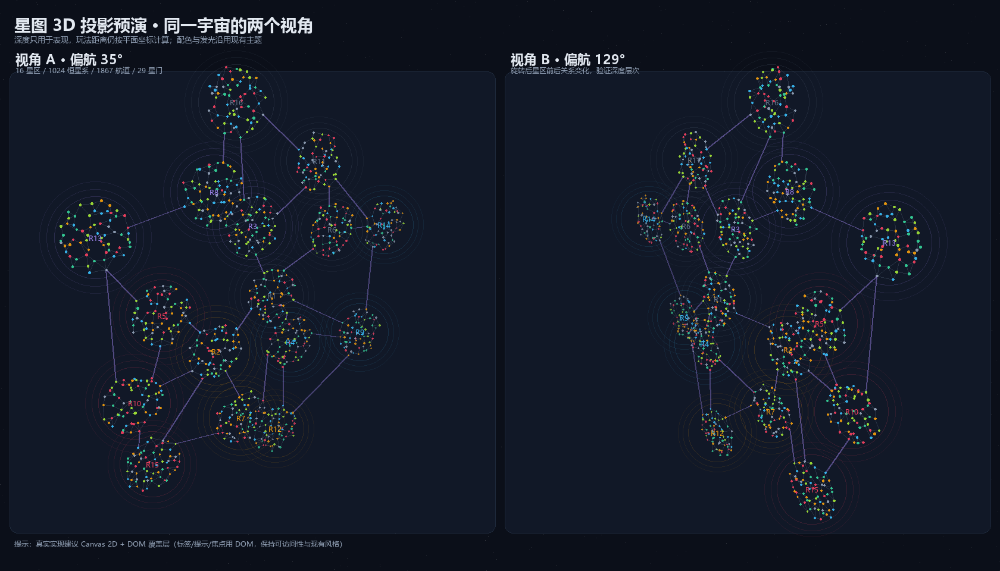

# 星图 UI 交互稿

> **当前实现**：星系页已改为 2.5D 三级星图（当前恒星系 / 本星系 / 银河全景），
> 旧表格视图和 3D 飞行视图已移除；后文第 14 节及之后的 3D 内容属于历史设计记录。

> 配套：[GALAXY_REDESIGN.md](./GALAXY_REDESIGN.md)（总体）、[GALAXY_MAP_DESIGN.md](./GALAXY_MAP_DESIGN.md)（布局与航道）、
> [GALAXY_SYSTEMS_DETAIL.md](./GALAXY_SYSTEMS_DETAIL.md)（结算与数值）。
>
> 本文只谈**界面与交互**：页面结构、线框、视觉规格、操作流、组件拆分、响应式与验收。

---

## 1. 设计原则

1. **地图即导航**：所有"去哪儿"的操作都从星图发起，不再有坐标输入框。
2. **信息分层**：银河看势力，区域看航道，星系看行星；每层只显示该层需要的字段。
3. **颜色不是唯一编码**：经济/危险同时用形状、描边、图标表达，照顾色觉差异。
4. **与现有风格一致**：沿用 `bg-background / text-muted-foreground / border / primary` 等主题变量，
   组件用现有 shadcn-vue 套件（Card / Sheet / Dialog / Popover / Tabs / Badge / ScrollArea）。
5. **移动端可用**：不依赖悬停；触屏用点击 + 底部抽屉。

### 布局预演图



上图由 `scripts/galaxy_preview.py` 真实跑一遍布局算法生成（仅设计工具，不参与构建），
可以直观看到：16 个星区、1024 个恒星系、区内航道网、跨区星门，以及一条 28 段的示例航线。

---

## 2. 页面结构与路由

```
/galaxy                    星图（默认区域视图）
  ?galaxy=3&system=27      深链接到某恒星系（兼容旧参数）
/galaxy/system/:systemId   星系视图（恒星 + 轨道 + 行星）
```

- 星图与星系视图是**同一个页面的两级**（不整页跳转，右侧抽屉/主区域切换），
  只有深链接时才整页进入星系视图。
- 旧的 `GalaxyView` 拆成：`GalaxyMapView`（新）+ `SystemView`（新）+ `useGalaxySelection`（共享选择逻辑）。

```
┌──────────────────────────────────────────────────────────────┐
│ 星图  [银河] [区域] [星系]        🔍筛选  🌐图例   ⟳ 刷新      │  ← 顶栏
├───────────────────────────────────────────────────┬──────────┤
│                                                   │          │
│                 GalaxyCanvas                      │  详情面板 │
│            （SVG，可缩放/平移/选择）                │  (Sheet) │
│                                                   │          │
│                                                   │          │
├───────────────────────────────────────────────────┴──────────┤
│ 图例：●经济  ○危险  ⬦星门  ─航道     选中：3:27 距离 4.2 光年   │  ← 底部状态栏
└──────────────────────────────────────────────────────────────┘
```

三层用同一个画布，靠**缩放级别（LOD）**切换：

| 级别 | 显示内容 | 触发 |
|---|---|---|
| 银河 | 16 个星区云团 + 星门连线 | 缩放 < 0.25 |
| 区域 | 64 个恒星系点 + 区内航道 | 0.25 ≤ 缩放 < 2 |
| 星系 | 恒星 + 10 条轨道（主区域切换为星系视图） | 缩放 ≥ 2 或点击恒星系 |

---

## 3. 线框

### 3.1 银河视图（区域层）

```
┌──────────────────────────────────────────────────────────────┐
│ 星图   [银河] 区域  星系            🔍   🌐   ⟳              │
├──────────────────────────────────────────────────────────────┤
│                                                              │
│            ╭──────╮                    ╭──────╮              │
│           │ 星区 2 │═══════════════════│ 星区 7 │              │
│            ╰──────╯      ╲             ╰──────╯              │
│                          ╲                                   │
│   ╭──────╮                ╲        ╭──────╮                  │
│  │ 星区 1 │                 ╲      │ 星区 5 │                  │
│   ╰──────╯                  ╲      ╰──────╯                  │
│                              ╲                               │
│                        ╭──────╮                              │
│                       │ 星区 3 │─── 中立（未探索）            │
│                        ╰──────╯                              │
│                                                              │
└──────────────────────────────────────────────────────────────┘
每个星区云团：半径 ∝ 恒星系数，填充 = 主导派系色，透明度随探索度
星门连线：虚线，粗 ∝ 航道等级，红色 = 被封锁
```

### 3.2 区域视图（恒星系层，主力界面）

```
┌──────────────────────────────────────────────────────────────────────┐
│ 星图   银河  [区域]  星系    区域 3 · 织女星区     🔍  🌐  ⟳          │
├────────────────────────────────────────────┬─────────────────────────┤
│                                            │  3:27  · 开普勒-186      │
│        ·3:12       ·3:41                   │  ─────────────────────   │
│           ╲        ╱                       │  恒星  K 型橙矮星         │
│            ╲      ╱                        │  经济  矿业 (mining)      │
│    ·3:07────●3:27────●3:33                 │  繁荣  ★★☆               │
│            ╱      ╲                        │  危险  ★★☆               │
│           ╱        ╲                       │  派系  深空议会           │
│        ·3:19       ·3:02        ⬦3:55      │  行星  6 颗（已扫描 L2）   │
│           │                                │  ─────────────────────   │
│        ·3:44                               │  [扫描] [设为航行目标]     │
│                                            │  [进入星系]               │
│                                            │                          │
│  ◇ 星门   ● 恒星系（大小=行星数）           │  发现者：Commander_7      │
└────────────────────────────────────────────┴─────────────────────────┘
```

- 恒星系点：`r = 3 + 行星数 * 0.3`，填充 = 经济类型色，描边 = 危险度
- 已发现但未扫描：填充降透明度 40% + `?` 角标
- 未发现：仅一个 2px 灰点，无名称（悬停显示"未知信号"）
- 星门：菱形，被占领时加派系色环

### 3.3 星系视图（恒星 + 轨道）

```
┌──────────────────────────────────────────────────────────────────────┐
│ ← 返回星图      3:27 开普勒-186        [扫描]  [设为航行目标]           │
├──────────────────────────────────────────────────────────────────────┤
│                                                                      │
│                         ☀ 恒星                                        │
│            ╭──────────────● 轨道 1  岩石行星（你）                      │
│           ╱   ╭───────────○ 轨道 2  海洋行星 · 中立                    │
│          ╱   ╱   ╭────────● 轨道 3  熔岩行星 · 可殖民                  │
│         ╱   ╱   ╱   ╭─────◌ 轨道 4  气态巨行星 · 不可殖民              │
│        ╱   ╱   ╱   ╱                                                 │
│                                                                      │
├──────────────────────────────────────────────────────────────────────┤
│ 轨道 1 · 家园星       所有者：你        矿脉 ████████░░ 82%           │
│ [殖民] [侦查] [攻击] [运输] [导弹] [传感器扫描]   ← 选中行星后显示       │
└──────────────────────────────────────────────────────────────────────┘
```

- 行星图标按地貌区分（岩石/海洋/沙漠/冰封/毒气/熔岩/气态/贫瘠）
- 圆点大小 = 行星大小等级；实心 = 有人，空心 = 无人
- 点击行星 → 底部操作条（沿用现有 `GalaxyView` 的操作集合，一个都不少）

### 3.4 航线规划（选中目标后）

```
┌──────────────────────────────────────────────────────────────┐
│ 航行计划  3:07 → 5:12                                        │
│ ─────────────────────────────────────────────────────────   │
│ ① 3:07 → 3:27   航道  0.8 光年   ⏱ 6m   ⛽ 12                │
│ ② 3:27 → 3:55   星门  1.4 光年   ⏱ 9m   ⛽ 21  （过路费 200）  │
│ ③ 3:55 → 5:12   直飞  2.1 光年   ⏱ 22m  ⛽ 38                │
│ ─────────────────────────────────────────────────────────   │
│ 合计：4.3 光年 · 37 分钟 · 71 重氢 + 200 过路费                │
│                                    [取消]  [派遣舰队]         │
└──────────────────────────────────────────────────────────────┘
```

- 路径在画布上以**黄色折线**高亮，每段中点显示悬浮徽标（距离/时间/燃料）
- 经过他国星门时该段描边变橙色并标注过路费
- 被封锁的航道用红色虚线 + 禁止图标，规划会自动绕开

---

## 4. 视觉规格

### 4.1 色板（全部映射到 Tailwind / 主题变量）

| 用途 | 取值 | 说明 |
|---|---|---|
| 经济 · 矿业 | `text-amber-500` | 暖黄 |
| 经济 · 工业 | `text-slate-400` | 中性 |
| 经济 · 科技 | `text-sky-400` | 冷蓝 |
| 经济 · 贸易 | `text-emerald-400` | 绿 |
| 经济 · 农业 | `text-lime-500` | 黄绿 |
| 经济 · 军事 | `text-rose-500` | 红 |
| 危险 1/2/3 | `stroke-muted-foreground` / `stroke-amber-500` / `stroke-destructive` | 描边 |
| 星门 | `text-violet-400` | 菱形 |
| 航道 | `stroke-border`，封锁时 `stroke-destructive` 虚线 | |
| 选中 | `ring-2 ring-primary` | 外圈 |
| 迷雾 | `opacity-30` | |

### 4.2 尺寸与字号

| 元素 | 规格 |
|---|---|
| 恒星系点半径 | 3 / 4 / 5 / 6 px（按行星数 0-3 / 4-6 / 7-8 / 9-10） |
| 悬停放大 | ×1.4，150ms ease-out |
| 航道线宽 | 1px，星门航道 2px |
| 标签 | `text-[10px]` 只在缩放 ≥ 0.8 时显示 |
| 详情面板 | 桌面 360px 固定宽；移动端全宽底部抽屉 |

### 4.3 状态色

| 状态 | 表现 |
|---|---|
| 未发现 | 灰点 + 无标签，悬停"未知信号" |
| 已发现 L1 | 经济色 + 名称 |
| 已扫描 L2 | + 行星数小圆点 |
| 已访问 | + 发现者昵称 |
| 已占领 | 派系色环 |
| 事件中 | 图标光晕（海盗红/风暴蓝/热潮金） |

---

## 5. 交互清单

### 5.1 鼠标 / 触屏

| 操作 | 行为 |
|---|---|
| 滚轮 / 双指捏合 | 以光标为锚点缩放（0.05 ~ 4） |
| 拖拽空白 | 平移 |
| 悬停节点 | Tooltip：名称、经济、危险、是否已发现 |
| 单击节点 | 选中 + 右侧详情面板 |
| 双击节点 | 进入星系视图 |
| 右键节点 | 上下文菜单：设为航行目标 / 扫描 / 复制坐标 / 标记 |
| 双击空白 | 放大一级 |
| 触屏单击 | 选中 + 底部抽屉 |
| 触屏长按 | 上下文菜单 |

### 5.2 键盘（可访问性）

| 键 | 行为 |
|---|---|
| `Tab` | 在节点间移动焦点（按距离排序） |
| `Enter` | 选中 / 进入 |
| `Esc` | 关闭面板 / 取消路径规划 |
| `+` / `-` | 缩放 |
| `0` | 复位视图 |
| 方向键 | 平移到相邻节点 |

### 5.3 过滤器与图例

- 顶部 `🔍` 打开过滤器 Popover：
  - 经济类型（多选）
  - 危险度（1/2/3）
  - 派系
  - 仅显示已发现 / 仅显示有航道
  - 资源偏向（P5）
- 过滤只影响**显示**，不影响选择与规划
- 图例固定在底部状态栏，可折叠

### 5.4 迷雾与未探索

- 未发现恒星系仍渲染（灰点），保证星图不出现"空洞"
- 悬停只显示"未知信号 · 距离 x 光年"
- 点击 → 详情面板提示"需要扫描"，按钮置灰并显示所需探测器数量
- 扫描完成后**原地动画**：灰点 → 经济色扩散，名称打字机效果（300ms）

### 5.5 空 / 载入 / 错误状态

| 状态 | 表现 |
|---|---|
| 首次进入 | 画布骨架 + 区域云团逐个淡入（每 40ms 一个） |
| 正在扫描 | 节点外圈转圈，按钮 disabled |
| 规划失败（超出跳跃距离） | 面板红色提示 + 建议"增加曲速等级或改用多段" |
| 网络断开 | 顶部横幅"连接已断开，星图为缓存数据" |
| 无任何发现 | 居中提示"从母星系开始扫描" + 指向按钮 |

---

## 6. 状态机

```
idle ──点击节点──▶ selected ──点击"设为航行目标"──▶ planning
                      │                              │
                      │◀────────取消──────────────────┘
                      │
                      └──双击──▶ systemView ──返回──▶ idle
planning ──确认派遣──▶ sent（Toast + 舰队列表高亮）
planning ──无可行路径──▶ planning(error)
```

- `selected` 与 `planning` 都保存在 `useGalaxySelection`，可被 URL 恢复
- 派遣成功后**不清空选择**（方便连续操作）

---

## 7. 响应式

| 断点 | 布局 |
|---|---|
| ≥1024px | 左画布 + 右 360px 详情面板 |
| 768~1023px | 画布全宽 + 右侧 300px 抽屉（可收起） |
| <768px | 画布全宽 + 底部抽屉（高度 55%，可上拉至 90%）；过滤器改为全屏 Dialog |

移动端不做双指缩放（先给 `+/-` 按钮），降低实现与手势冲突成本。

---

## 8. 渲染与性能

- **纯 SVG**，三层 `<g>`：`g-regions` / `g-lanes` / `g-nodes`
- 缩放平移只改最外层 `<g transform>`，不重排
- 视口裁剪：只渲染包围盒内的节点（区域视图 64 个，全量渲染也无压力）
- 银河视图把 16 个星区合并成 16 个圆，不渲染 1024 个节点
- 节点用 `<circle>` + `<text>`，避免引入 Canvas/WebGL
- Tooltip 用固定定位的单个 DOM 节点，跟随鼠标（不走 SVG）
- 路径动画用 `stroke-dasharray` + CSS `animation`，不逐帧计算

估算：区域视图 DOM 节点 ~64 + 航道 ~96 + 标签 ~64 ≈ 230 个元素，滚动/缩放稳定 60fps。

---

## 9. 组件拆分

```
src/components/galaxy/
  GalaxyCanvas.vue        画布（缩放/平移/命中测试/事件分发）
  RegionLayer.vue         银河层的星区云团
  LaneLayer.vue           航道（含封锁、星门、高亮）
  SystemNode.vue          单个恒星系节点（含状态徽标）
  RouteOverlay.vue        航行路径折线与分段徽标
  SystemDetailSheet.vue   右侧/底部详情面板
  RoutePlannerPanel.vue   航行计划确认
  GalaxyFilters.vue       过滤器 Popover
  GalaxyLegend.vue        图例
  PlanetOrbitView.vue     星系视图（恒星 + 轨道 + 行星）

src/composables/
  useGalaxyViewport.ts    缩放/平移/坐标换算
  useGalaxySelection.ts   选中、深链接、路径规划状态
  useGalaxyLOD.ts         缩放级别 → 显示内容

src/components/cycle/      周目相关（详见 §13.9）
  CycleBadge.vue / CyclePanel.vue / CycleJumpPanel.vue
  JumpBanner.vue / CoreGateOverlay.vue
```

现有 `GalaxyView.vue` 里的行星操作（侦查/攻击/导弹/殖民/运输/传感器）整块搬到
`SystemDetailSheet.vue`，接口不变，只改外层容器。

---

## 10. 与旧页面的关系

| 旧 | 新 |
|---|---|
| `GalaxyView` 顶部的 galaxy/system 两个下拉 | 星图缩放 + 点击选择；下拉保留在星系视图顶部作为快速跳转 |
| `GalaxyView` 的 10 个槽位卡片 | `PlanetOrbitView` 的轨道图 + 底部操作条 |
| 列表模式 | 保留一个"列表视图"开关（表格：轨道/归属/地貌/防御/操作），供密集操作 |

迁移期先并行：新星图作为 `/galaxy` 默认，旧列表挂在 `?view=list`，验证一轮后再删旧代码。

---

## 11. 可访问性

- 每个节点有 `role="button"` + `aria-label`（名称 + 经济 + 危险 + 是否已发现）
- 焦点环 `ring-2 ring-primary`，与 hover 视觉等价
- 危险度不只靠颜色：描边粗细 + `aria-label` 文本
- 路径规划结果用 `aria-live="polite"` 播报
- 对比度：灰点（未知）对背景 ≥ 3:1

---

## 12. UI 验收清单

- [ ] 银河/区域/星系三级缩放切换无闪烁，LOD 阈值不抖动（±5% 迟滞）
- [ ] 1024 个节点全部可达（键盘 Tab 能遍历区域视图的 64 个）
- [ ] 缩放锚点正确（光标下的节点不发生位移）
- [ ] 选中态、迷雾、封锁、事件光晕四种状态可同时正确显示
- [ ] 路径规划：≤ 1 次跳转时也能正确显示；无解时给出明确原因
- [ ] 移动端（375px 宽）底部抽屉不遮挡画布操作
- [ ] 深链接 `?galaxy=3&system=27` 能恢复选中与详情
- [ ] 断线横幅出现时，画布操作仍然可用（只读）
- [ ] 色觉模拟（deuteranopia）下仍能区分经济类型（靠图标/形状）
- [ ] 周目栏在 375px 宽下不换行、徽章不挤压
- [ ] 跃迁倒计时在页面切走后回来仍正确（以服务端 `endsAt` 为准）
- [ ] 跃迁完成后的"抵达"过场可跳过，且跳过不影响后续操作

---

## 13. 周目 UI

> 机制见 [GALAXY_CYCLES.md](./GALAXY_CYCLES.md)。这一节只谈界面。

### 13.1 周目栏（星图顶栏）

```
┌──────────────────────────────────────────────────────────────────────┐
│ 星图  [银河] 区域 星系        ┌──────────┐  🔍   🌐   ⟳            │
│                              │ 宇宙 III ▾ │  ← 周目切换器            │
└──────────────────────────────────────────────────────────────────────┘
```

- 点击「宇宙 III」打开**周目面板**（右侧 Sheet，与详情面板同位置，互斥）
- 徽章样式：`Badge variant="outline"` + 罗马数字；第 1 周目显示「起源」
- 跃迁进行中时徽章变成金色 + 呼吸动画，点击直接打开跃迁进度

### 13.2 周目面板

```
┌────────────────────────────────────┐
│ 周目                          ✕    │
│ ─────────────────────────────────  │
│ 当前：宇宙 III（第 3 层）           │
│ 在线 4 人 · 最高抵达 第 5 层        │
│ ─────────────────────────────────  │
│ 各层状态                            │
│  Ⅰ 起源       🔒 冻结   2 人        │
│  Ⅱ 荒芜       ● 活跃   1 人        │
│  Ⅲ 炽焰       ● 当前   4 人   [查看]│
│  Ⅳ 深空       ○ 未探索             │
│  Ⅴ 终末       ○ 未探索   ★ 有人到过 │
│ ─────────────────────────────────  │
│ [ 跃迁到下一层 ]  [ 下潜到低层 ]    │
└────────────────────────────────────┘
```

- 每层显示：序号、代号、状态（活跃/冻结/未探索）、在线人数
- 「有人到过」用星标标出，便于判断要不要跟上去
- 冻结层灰显，点击提示"需要该层玩家重新激活"

### 13.3 跃迁面板（从核心星门或周目面板进入）

```
┌──────────────────────────────────────────┐
│ 跃迁至 宇宙 IV（第 4 层）            ✕   │
│ ──────────────────────────────────────   │
│ 条件检查                                  │
│  ✓ 抵达银河核心（3:27 · 核心星门）        │
│  ✓ 曲速引擎 5 级                          │
│  ✓ 天体物理 10 级                         │
│  ✗ 资源不足  金属 1.2M / 2.4M            │
│ ──────────────────────────────────────   │
│ 代价                                      │
│  拆除 6 颗星球 → 补给包 +60% 建筑价值     │
│  回收 3 支舰队 → 补给包 +40% 舰船价值     │
│  保留：科技 · 成就 · 军官                  │
│ ──────────────────────────────────────   │
│ ⏱ 倒计时 24 小时（全服可见）              │
│              [ 取消 ]  [ 开始跃迁 ]        │
└──────────────────────────────────────────┘
```

- **条件清单**逐条打勾/打叉，缺什么直接显示进度（`1.2M / 2.4M`）
- 代价做成"失去 / 保留"两栏对照，避免玩家误操作
- 开始后按钮变「取消跃迁（退 80%）」

### 13.4 倒计时与全服广播

```
┌──────────────────────────────────────────────────────────────┐
│ 🚀 Commander_7 正在跃迁至 宇宙 IV · 剩余 18:42:11            │
└──────────────────────────────────────────────────────────────┘
```

- 顶部横幅（所有玩家可见），点击跳转到核心星区
- 星图上核心星区显示**金色光柱**，随倒计时收缩
- 倒计时结束：全服广播 + 跃迁者播放「抵达」过场（3 秒可跳过）

### 13.5 下潜选择

```
┌──────────────────────────────────────────┐
│ 下潜至                                 ✕ │
│ ──────────────────────────────────────   │
│ ○ 宇宙 II  荒芜   在线 1 人               │
│ ● 宇宙 I   起源   在线 2 人  ⚠ 高层压制   │
│ ──────────────────────────────────────   │
│ 冷却：72 小时（上次跃迁 3 小时前）        │
│ ⚠ 你的舰队在低层作战时会受到层压制        │
│              [ 取消 ]  [ 下潜 ]           │
└──────────────────────────────────────────┘
```

- 只能选低于当前层的目标
- 明确提示「层压制」系数（`战力 ×0.6`）与冷却剩余时间
- 目标层有玩家时显示人数，方便"去帮忙/去打架"

### 13.6 核心星门在地图上的表现

| 层级 | 表现 |
|---|---|
| 银河视图 | 中央星区中心一个金色光点 + 环 |
| 区域视图 | 核心恒星系金色描边 + 环绕旋转的粒子（CSS 动画） |
| 星系视图 | 核心轨道上的星门图标，点击打开跃迁面板 |
| 未满足条件 | 图标灰显，悬停显示"需要曲速 5 级" |

### 13.7 状态机

```
idle ──点击核心/周目面板──▶ inspect
inspect ──条件满足并确认──▶ charging（24h 倒计时，全服可见）
charging ──取消──▶ idle（退 80%）
charging ──倒计时结束──▶ arriving（过场 3s）──▶ moved（新层星图）
inspect ──条件不足──▶ inspect(disabled，显示缺失项)
```

- `charging` 状态在**任何页面**都能看到（顶部横幅）
- 刷新页面后从服务端 `endsAt` 恢复倒计时，不依赖本地计时器

### 13.8 排行榜的周目维度

- 排行榜页顶部加周目标签页：`宇宙 I | 宇宙 II | 宇宙 III | 总览`
- 「总览」显示各层前 3 + 「最高抵达层」徽章
- 不跨层加权求和（避免"刷低层"影响总榜）

### 13.9 新增组件

```
src/components/cycle/
  CycleBadge.vue        顶栏周目徽章（含跃迁中状态）
  CyclePanel.vue        周目面板（各层列表）
  CycleJumpPanel.vue    跃迁/下潜条件与代价确认
  JumpBanner.vue        全服跃迁横幅 + 倒计时
  CoreGateOverlay.vue   星图上的核心光柱/图标
```

### 13.10 周目相关文案（进语言包）

```ts
cycle.title / cycle.current / cycle.online / cycle.highest
cycle.status.active / frozen / unexplored
cycle.jump / cycle.dive / cycle.cancel / cycle.confirm
cycle.condition.ok / missing
cycle.keep / cycle.lose
cycle.countdown / cycle.arriving / cycle.cooldown
cycle.pressure.warning      // 层压制提示
```

---

## 14. 历史设计：3D 星图（已由 2.5D 星图取代）



> 上图由 `scripts/galaxy_3d_preview.py` 用真实布局算法 + 透视投影渲染，
> 同一宇宙的两个偏航角，用于判断深度层次是否成立。

### 14.1 结论：可以做，但不需要 WebGL

现状约束：项目零 3D 依赖，`ParticlesBg.vue` 已有 Canvas 2D 画星空；
星图规模 1024 节点 / ~1800 条航道，属于"中等规模点线图"。

| 方案 | 实现 | 包体积 | 风格一致性 | 可访问性 | 推荐 |
|---|---|---|---|---|---|
| **A. 纯 2D**（原方案） | SVG | 0 | ★★★★★ | ★★★★★ | 保守选择 |
| **B. Canvas 2D + 透视投影** | 自己的 3D 数学 + Canvas | **0**（无新依赖） | ★★★★☆ | ★★★★（DOM 覆盖层） | ✅ **推荐** |
| C. WebGL / Three.js | 新依赖 + 着色器 | +150KB gzip | ★★★☆（发光/体积雾要自己写） | ★★ | 仅当要体积星云 |

**推荐 B**：用和 2D 完全相同的调色板与数据，额外加一个"深度轴"和相机，
渲染层换成 Canvas（本来就有先例），标签/提示/焦点仍用 DOM 覆盖层。

### 14.2 深度从哪来

- 每个星区由种子派生一个 `z`（±2600 单位），恒星系继承星区 z + 少量抖动；
- **z 只用于渲染**：`calculateDistance`、航道跳数、扫描射程全部仍按平面坐标计算，
  所以 3D 不会改变任何平衡与已有数值；
- 这样"视觉上 3D、规则上 2D"，避免重新标定全部航程（这是最容易翻车的地方）。

### 14.3 风格一致性

| 元素 | 做法 |
|---|---|
| 配色 | 直接复用 `galaxy.economy.*` 对应的 Tailwind 色，不引入新色板 |
| 背景 | 深空 + 稀疏星点，与现有 `StarsBackground` / `ParticlesBg` 同款 |
| 发光 | 区域用 2~3 层同心圆描边模拟辉光（Canvas `shadowBlur` 在低端机很贵，避免） |
| 深度雾 | 远的节点降低 alpha、缩小半径，雾色 = 背景色 |
| 字体 | DOM 层用现有字体栈，Canvas 只画点线不画文字 |
| 交互态 | 选中环、悬停放大、路径高亮，与 2D 方案的视觉规则完全一致 |

### 14.4 交互

| 操作 | 3D 下的行为 |
|---|---|
| 拖拽 | 绕星系中心旋转（yaw / pitch，pitch 限制 ±70°） |
| 滚轮 | 沿视线推拉（改变相机距离，不是缩放画布） |
| 双击节点 | 相机飞向该星区（缓动 400ms） |
| 单击 | 选中 + 右侧面板（DOM） |
| 键盘 | `Tab` 遍历节点（按屏幕距离排序）、`WASD` 旋转、`+/-` 推拉 |
| 拾取 | 用投影后的屏幕坐标做最近点判定；重叠时优先近处节点 |

### 14.5 性能预算

| 项 | 目标 |
|---|---|
| 每帧绘制 | ≤ 1024 圆 + 1800 线段（按深度排序） |
| Canvas 尺寸 | 设备像素比上限 2 |
| 帧率 | 桌面 60fps、千元机 ≥ 30fps |
| 降级 | 帧时间 > 22ms 连续 3 帧 → 关深度雾/减半线宽/跳帧渲染 |
| 静态场景 | 相机不动时不重绘（`requestAnimationFrame` 按需触发） |

### 14.6 分期

| 阶段 | 内容 | 人日 |
|---|---|---|
| V1 | 只读 3D 星图：布局 + 透视 + 拖拽旋转 + 缩放 | 3~4 |
| V2 | 交互：拾取、选中、详情面板、航线高亮、键盘 | 3~4 |
| V3（可选） | WebGL 体积星云、星门光束、事件粒子 | 5~8 |

> V1+V2 与 2D 方案的 P3 工作量基本持平（多 1 天左右），
> 因为**数据层和面板层完全复用**，只是渲染器换了。

### 14.7 风险

| 风险 | 说明 | 缓解 |
|---|---|---|
| 眩晕 | 自由旋转 + 快速拖拽 | 缓动、限制 pitch、提供"俯视/斜视"两个预设角度 |
| 遮挡 | 远处的星区被近处挡住 | 深度雾 + 悬停穿透高亮 + 平面/3D 一键切换 |
| 移动端性能 | 1024 圆 + 1800 线 | 降级策略 + 区域视图只渲染视口内节点 |
| 可访问性 | Canvas 无 DOM 语义 | 覆盖层镜像节点（`role=button` + `aria-label`），与 2D 方案同一套 |
| 参考系迷失 | 转完后不知道自己在哪 | 常驻"银河系中心"指示 + 小地图（2D 缩略图） |

### 14.8 飞行视图（V1.5 已实现）

在 V1 的俯视相机之外，又加了一版**第一人称飞行**视图（`/starmap`），目标是
《无人深空》那种"身在银河中"的浩瀚感。

**视觉模型**

```
玩法坐标 (x, y)  ──旋臂扭曲──▶  视觉位置 (x', y')
                                    │
                         盘面厚度 z（近核球更厚）
                                    ▼
                        第一人称相机 + 视距雾化
```

- `spiralWarp(x, y, space, twist)`：绕银心旋转，旋转角与半径成正比 —— 把均匀分布的星团拧成旋臂，
  **保持半径不变**（不会打乱远近关系）；
- `diskDepth(seed, id, radius)`：银心附近更厚（核球），外围更薄，用近似高斯抖动；
- 相机在盘面内部，`projectInView` 做视空间投影，**背后与超出视距的节点直接剔除**；
- `fogAlpha(distance, viewRadius)`：1.4 次幂渐隐，配合全屏径向渐变遮罩（vignette）制造"视线有限"。

**交互**

| 操作 | 效果 |
|---|---|
| 拖拽 | 环顾（yaw / pitch，pitch 限制 ±69°） |
| `W/S` | 前进 / 后退 |
| `A/D` | 左右平移 |
| `Q/E` | 升降 |
| `Shift` | 4 倍加速 |
| 滚轮 | 调整巡航速度（150 ~ 6000 u/s） |
| 预设按钮 | 银河全景 / 旋臂巡航 / 银心 |

**性能**

- 每帧只投影 1024 恒星系 + 900 尘埃 + 700 背景星，超出视距的直接跳过；
- 节点按深度排序后一次绘制，近处加一圈低透明度辉光；
- 设备像素比上限 2；页面隐藏时跳过渲染；
- 实测 chunk 6.9 KB（懒加载，不影响首屏）。

**明确的取舍**

- 视觉位置与玩法坐标**分离**：飞行视图里的相对位置不参与任何距离/航道计算，
  等 V2 做"点击恒星系 → 派舰队"时再决定要不要统一两套坐标；
- 还没有：节点拾取、恒星系名称、航道连线、发现迷雾、双指缩放。

### 14.9 V2 交互（已实现）

在飞行视图上加了**点选 + 详情面板**，把 P2 的扫描/命名接进了界面：

| 操作 | 行为 |
|---|---|
| 点击星点 | 选中（黄色选中环）+ 右侧详情面板；点击空白取消选中 |
| 拖动 | 位移 > 4px 判定为拖拽，不会误触发选中 |
| 面板内容 | 名称、坐标、经济类型、危险度、繁荣度、空间站、到相机距离、发现状态 |
| 扫描按钮 | `galaxy.scan`（母星出发；消耗探测卫星 + 重氢；受射程/冷却限制） |
| 命名 | `galaxy.rename`（首名者命名权，2~24 字） |

拾取实现：每帧把投影结果写进 `pickTargets`，点击时取屏幕距离最近且在
`max(14px, 半径+8)` 内的节点——比反投影简单，且与渲染完全一致。

面板是普通 DOM（不是 Canvas），因此天然支持键盘、选中文本与屏幕阅读器。

### 14.10 行星轨道（已实现）

选中恒星系后，详情面板下方直接列出该系的 10 条轨道：

| 状态 | 显示 |
|---|---|
| 自己的星球 | 绿色底 + 星球名 |
| NPC 星球 | 深色底 + NPC 名字（来自 `npcStore`） |
| 其他玩家 | 深色底 + 玩家名（来自 `netStore.players`） |
| 空闲轨道 | 灰色 + "空闲轨道" |

每行右侧显示该轨道的地貌（`getPlanetProfile` 实时推导，不落盘），
底部「在星系页操作」跳转到 `/galaxy?galaxy=&system=`，把殖民、派舰队、
导弹等既有操作接回原来的页面。

> 这样"扫描 → 看轨道 → 派舰队"的链路就通了：
> 星图负责**发现与战略视野**，星系页负责**具体操作**。

### 14.11 主题一致性

星图不能是"黑底孤岛"，所有颜色都跟随主题：

| 元素 | 来源 |
|---|---|
| 画布背景 | `--background`（直接读 CSS 变量） |
| 文字 / 标题 | `text-foreground` |
| 辅助文字 / HUD | `text-muted-foreground` |
| 面板 / 边框 | `bg-card` / `border-border` |
| 经济类型色 | 明暗两套：夜间用亮色（`#f59e0b`），白天用深色（`#b45309`） |
| 航道 / 星门 | 深色主题青紫，浅色主题加深 |
| 背景星 / 尘埃 / 选中环 / 核心光晕 | 同样两套 |

**切换机制**：`MutationObserver` 监听 `<html class>` 的 `dark` 变化，
颜色从 `getComputedStyle` 读取 CSS 变量，所以**自定义主题色也能跟上**；
渲染循环每帧读取色板，切换后下一帧即生效。

**对比度约束**（对应用户要求）：

- 正文一律 `text-foreground`，辅助信息一律 `text-muted-foreground`（shadcn 配对自带对比度保证）；
- 不再出现 `text-slate-*` / `bg-black` 这类硬编码；
- 浅色主题下星体改用深色版，避免"白底白星"；
- 暗角渐变的终点色 = 主题背景色，而不是固定的黑色。
